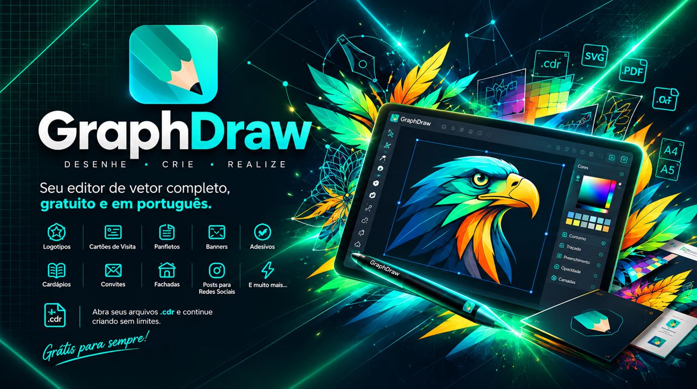

<p align="center">
  
</p>

#  GraphDraw (English summary)

**A vector illustration, layout and print editor made for print shops and
sign makers.** It opens and saves real `.cdr` files, exports PDF/X for print
and PLT for cutting plotters, and runs as a native program on Windows, macOS
and Linux, and in the browser. Open source, written in Rust. The main README
is in Brazilian Portuguese: [README.md](README.md).

- **Download:** [releases](https://github.com/geifison/GraphDRAW/releases) (installers for every platform, plus a nightly build)
- **Try it:** [in the browser](https://geifison.github.io/GraphDRAW/), nothing to install
- **Help:** [user help](https://geifison.github.io/GraphDRAW/help/en/) in 18 languages
- **Status:** alpha; the row-by-row picture is in [`docs/features.md`](docs/features.md)

## About the author

GraphDraw is led by **Geifison Queiroz Oliveira**, a designer with more than
20 years of creative work in printing and advertising: logos, brand identities,
point-of-sale material, shop fronts, campaigns and social media pieces. Years of
daily work with professional design tools taught him what helps and what gets
in the way of people with deadlines, and GraphDraw is where that experience
goes: millimetres first, paper and social media sizes at hand, files ready for
production without surprises, in a free editor anyone can use.

## Highlights

- Clean-room `.cdr` reader for versions 1 to 27 and writer for 14 to 27 (7 to 13 experimental); CMX, SVG, PDF, AI, EPS, DXF, PSD, EMF, WMF, HPGL and text documents too.
- Curves and nodes, shaping, live effects, artistic and paragraph text, every kind of fill, bitmaps with 98 effects and bitmap tracing.
- Multi-page documents, layers, guides, snapping, bleed, tables, symbols and clip frames; a New Document library of page sizes with measurement fields that take expressions and units (`210 mm`, `8.5 in`, `100+10 mm`).
- Output to PDF and PDF/X, separations, ICC colour management and every common vector and bitmap format.
- Every action is an undoable command: command line, JavaScript, VBA macros and an MCP server for AI agents.

## What's new

- New look: the pencil icon, a new splash screen and a new icon for `.gdr` files.
- Print preview: wheel and rectangle zoom, panning and real size; the Print dialog shows every tab whole.
- Clip frames: more objects, text frames, double-click and Ctrl+click editing, nested levels and a clip frame bar.
- Interactive gradient fill with on-canvas handles and stops; fill transparency; editable two-colour patterns.
- Eyedroppers that sample and pour colours and properties, with a magnifier and gradient stops.
- Floating Edit Fill (F11) and Outline Pen (F12) windows; outline transparency, miter limit, dashes at corners and arrow options.
- Text fitted to a path, with the caret and selection following the curve.
- System clipboard with SVG, text and PNG; drop files on the window to import them where they fall.
- Right-drag copies; right-click on a locked object offers Unlock.
- Align and Distribute with colour pictures and a Specified point target.
- Selection marks in black or white against the drawing under them.
- VBA macro projects with the Macro Manager, forms and editor.
- `.cdr` saving in the version you pick; no console window on Windows.

## Build

```sh
git clone https://github.com/geifison/GraphDRAW
cd GraphDRAW
cargo run --release -p graphdraw
cargo test --workspace
```

Contributors and AI agents start with [`AGENTS.md`](AGENTS.md) and
[`CONTRIBUTING.md`](CONTRIBUTING.md).

## Origin, license and credits

GraphDraw is a derivative work of [TraceDraw](https://github.com/igtoth/tracedraw)
by Ighor Toth and contributors (from commit `c7f4e9c`), which provides the
engine, the `.cdr` reader and most of the interface; see [`NOTICE.md`](NOTICE.md).
Dual-licensed under [MIT](LICENSE-MIT) or [Apache-2.0](LICENSE-APACHE).

Copyright &copy; 2026 Ighor Toth and the TraceDraw contributors.<br>
Copyright &copy; 2026 Geifison Queiroz Oliveira and the GraphDraw contributors.

<sub>GraphDraw is an independent project, not affiliated with, sponsored or
endorsed by any other software vendor. File format names are used only to
describe the files GraphDraw reads and writes.</sub>
