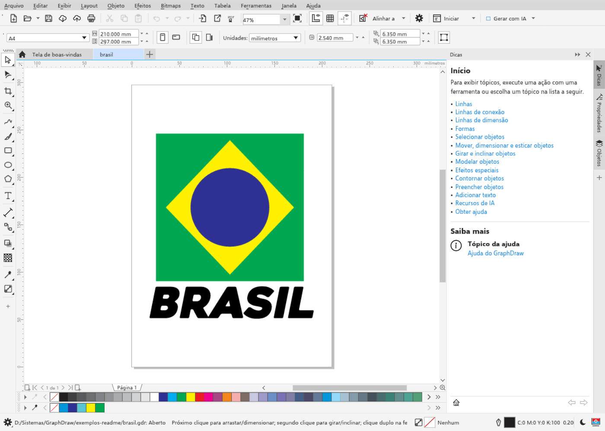
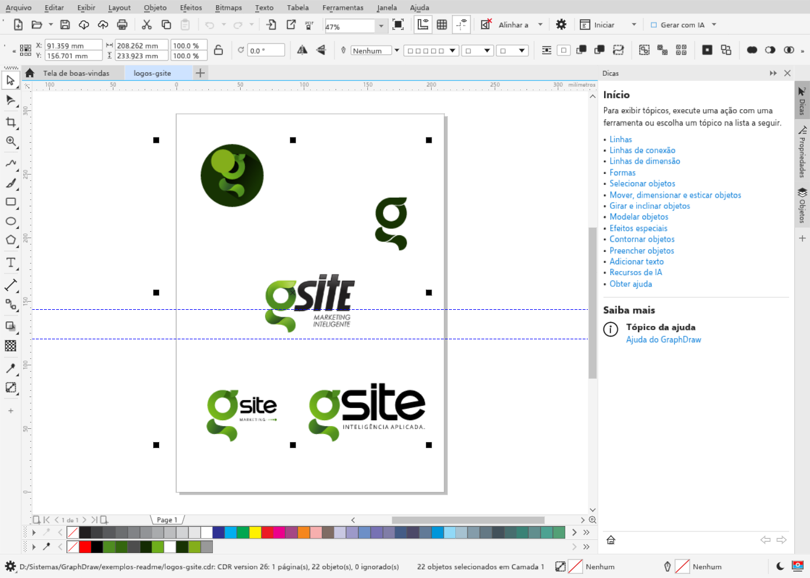
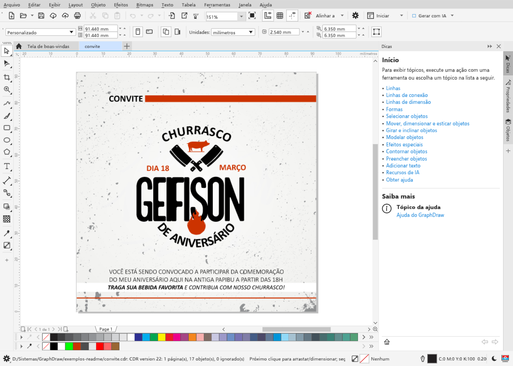
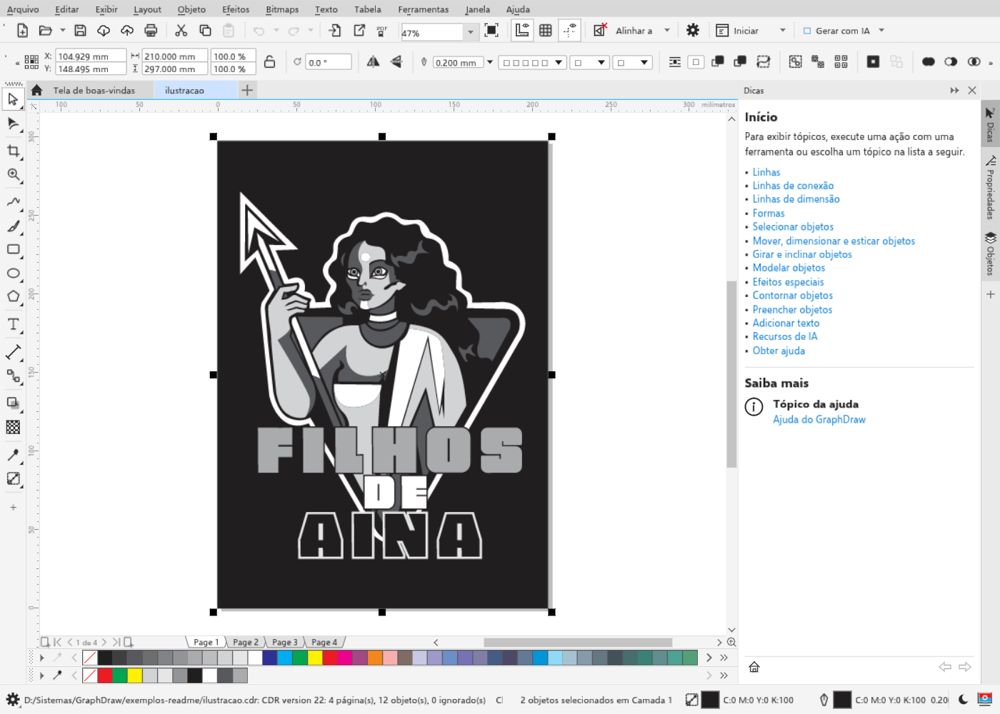
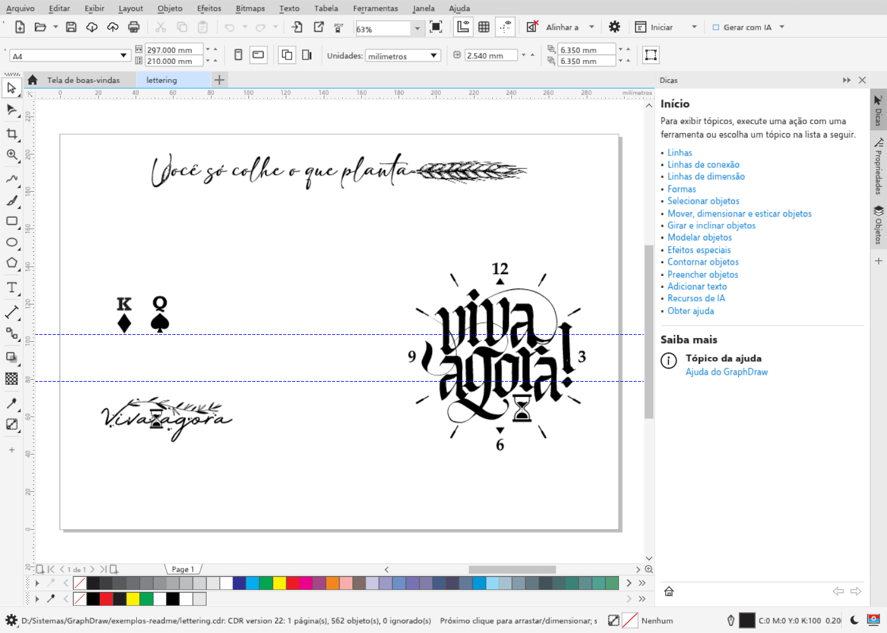
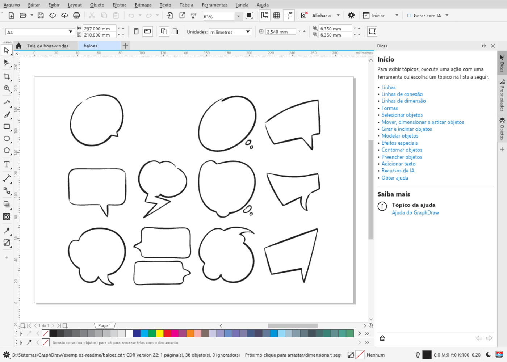

<p align="center">
  
</p>

<h3 align="center">Crie, ajuste e mande para a gráfica.<br>Um editor vetorial gratuito, feito por quem vive de criação.</h3>

<p align="center">
  <a href="https://github.com/geifison/GraphDRAW/releases/latest"></a>
  <a href="https://geifison.github.io/GraphDRAW/"></a>
  <a href="https://geifison.github.io/GraphDRAW/help/pt-BR/"></a>
</p>

<p align="center">
  Windows &middot; macOS &middot; Linux &middot; navegador &nbsp;|&nbsp; em português e mais 17 idiomas &nbsp;|&nbsp; código aberto &nbsp;|&nbsp; <a href="README.en.md">English</a>
</p>

<br>

<table>
  <tr>
    <td width="50%" valign="top">
      
      <sub><b>Feito no GraphDraw.</b> Desenho criado e salvo no próprio programa, no formato <code>.gdr</code>.</sub>
    </td>
    <td width="50%" valign="top">
      
      <sub><b>Logotipos.</b> Variações de marca abertas de um <code>.cdr</code> versão 26, com os 22 objetos selecionados.</sub>
    </td>
  </tr>
  <tr>
    <td width="50%" valign="top">
      
      <sub><b>Convites e peças sociais.</b> Texto, ícones e textura vindos de um <code>.cdr</code>, prontos para editar.</sub>
    </td>
    <td width="50%" valign="top">
      
      <sub><b>Ilustração vetorial.</b> Um arquivo de quatro páginas, com as páginas em abas na parte de baixo.</sub>
    </td>
  </tr>
  <tr>
    <td width="50%" valign="top">
      
      <sub><b>Lettering.</b> 562 curvas abertas sem perder nenhuma.</sub>
    </td>
    <td width="50%" valign="top">
      
      <sub><b>Elementos gráficos.</b> Balões de fala em curvas, prontos para reaproveitar.</sub>
    </td>
  </tr>
</table>

<p align="center"><sub>Capturas do próprio GraphDraw, geradas pelo teste <code>readme_shots</code> com trabalhos reais do autor.</sub></p>

---

## O que é o GraphDraw

É um programa para desenhar e montar arte em vetor: logotipos, cartões de
visita, panfletos, banners, adesivos, cardápios, convites, fachadas e posts.
Você desenha, escreve, ajusta as cores e, no fim, gera o arquivo que a gráfica,
a plotter ou a rede social precisa.

E ele abre os arquivos `.cdr` que você já tem guardados. Aquele logo de cliente
feito anos atrás abre, você mexe e salva de novo.

**É gratuito, para sempre.** Não tem assinatura, não pede cadastro e não manda
seus arquivos para lugar nenhum.

## Feito por quem é do ramo

<table>
  <tr>
    <td>
      Olá, eu sou o <b>Geifison Queiroz Oliveira</b>. Há mais de 20 anos trabalho
      com criação no ramo gráfico e publicitário: logotipos, identidades visuais,
      material de ponto de venda, fachadas, campanhas, peças para redes sociais e
      tudo o que sai de uma gráfica rápida ou de uma agência.
      <br><br>
      Nesse tempo usei muitos programas de criação e aprendi, na prática do dia a
      dia, o que ajuda e o que atrapalha quem tem prazo para entregar. O cliente
      que chega com um arquivo antigo, a arte que precisa sair em vários tamanhos,
      a cor que muda na impressão, o banner que tem que ir para a gráfica hoje.
      <br><br>
      O GraphDraw é onde estou colocando toda essa experiência. Cada tela é
      pensada para o fluxo real de quem cria: as medidas em milímetros, os
      formatos de papel e de redes sociais à mão, o arquivo pronto para a
      produção sem sustos. A ideia é simples: um editor profissional, livre e em
      português, que qualquer criativo possa usar, de quem está começando ao
      estúdio com anos de estrada.
    </td>
  </tr>
</table>

## O que você consegue fazer

| | |
|---|---|
| ✏️ **Desenhar** | Linhas, curvas, formas, estrelas, espirais. Cada ponto da curva pode ser ajustado depois. |
| 🔤 **Escrever** | Títulos e textos longos, em colunas, com as fontes do seu computador e correção ortográfica. |
| 🎨 **Colorir** | Cores em CMYK para impressão e RGB para tela, degradês, texturas e transparência. |
| ✨ **Dar efeito** | Sombra, contorno, mistura, perspectiva, envelope e outros, que continuam editáveis. |
| 🖼️ **Usar fotos** | Coloque imagens, aplique efeitos e transforme uma imagem em vetor. |
| 📄 **Montar páginas** | Várias páginas, camadas, guias, réguas e sangria, como numa revista ou num cardápio. |
| 🆕 **Começar rápido** | Escolha o formato pronto: A4, Ofício, cartão de visita, envelope, banner, post e stories. Digite medidas do seu jeito, como `210 mm`, `8.5 in` ou `100+10 mm`. |
| 🖨️ **Entregar** | PDF pronto para a gráfica (PDF/X, com sangria), PLT para plotter de recorte, PNG, JPG, SVG e outros. |

## Seus arquivos `.cdr` abrem aqui

- Abre arquivos `.cdr` de todas as versões (1 a 27) e também `.cmx`.
- Salva em `.cdr` de volta, na versão que você escolher (da 14 à 27), ou no formato próprio do GraphDraw, o `.gdr`.
- Também abre e salva SVG, PDF, AI, EPS, DXF, PSD, EMF, WMF e PLT.
- Se alguma parte do arquivo ainda não for lida, o programa avisa. Nada some calado.

O leitor de `.cdr` foi escrito de forma independente (em "sala limpa"), só a
partir de informações públicas e de arquivos próprios. Um arquivo que não abriu
direito? [Mande para nós](https://github.com/geifison/GraphDRAW/issues/new?template=cdr_file.yml)
(só arquivos que você pode compartilhar). É o que mais ajuda o programa a melhorar.

## Como começar

1. **Baixe** a versão do seu sistema na página de [versões](https://github.com/geifison/GraphDRAW/releases/latest):
   - **Windows:** o instalador `-setup.exe`, ou o `.zip` portátil. Se o Windows avisar que o programa é desconhecido, clique em *Mais informações* e depois em *Executar assim mesmo* (o programa ainda não tem assinatura digital).
   - **macOS:** o arquivo `.dmg`. Na primeira vez, clique com o botão direito no programa e escolha *Abrir*.
   - **Linux:** `.deb`, `.AppImage` ou `.tar.gz`.
2. **Ou use no navegador**, sem instalar nada: [geifison.github.io/GraphDRAW](https://geifison.github.io/GraphDRAW/).
3. **Precisa de ajuda?** A [ajuda em português](https://geifison.github.io/GraphDRAW/help/pt-BR/) explica cada ferramenta. No programa, aperte <kbd>F1</kbd>.

> [!NOTE]
> O GraphDraw está em **versão de testes (alfa)**. A maior parte já funciona,
> mas ainda podem aparecer defeitos. Guarde uma cópia dos seus arquivos
> importantes e, se algo der errado,
> [conte para nós](https://github.com/geifison/GraphDRAW/issues/new/choose).

## Quer ajudar?

Não precisa saber programar:

- 📂 **Teste com os seus arquivos** e avise o que não abriu bem.
- 🐞 **Conte os defeitos** que encontrar, com os passos e uma captura de tela.
- 🌍 **Revise a tradução** do seu idioma.
- ⭐ **Dê uma estrela** no projeto e indique para outros criativos.

<details>
<summary><b>Para programadores</b></summary>

<br>

O GraphDraw é escrito em Rust, com interface em egui. O mesmo código gera o
programa de computador e a versão do navegador (WebAssembly).

```sh
git clone https://github.com/geifison/GraphDRAW
cd GraphDRAW
cargo run --release -p graphdraw                  # abre o editor
cargo run --release -p graphdraw -- desenho.cdr   # abre um arquivo
cargo test --workspace                            # roda os testes
```

A linha de comando `graphdraw-cli` converte arquivos sem abrir a janela:

```sh
graphdraw-cli convert cartao.cdr cartao.pdf
GRAPHDRAW_PDFX=x1a GRAPHDRAW_BLEED=3 graphdraw-cli convert banner.cdr banner.pdf
GRAPHDRAW_DPI=300 graphdraw-cli convert logo.gdr logo.png
graphdraw-cli info arquivo.cdr
```

Cada ação do editor é um comando com desfazer, usado igualmente pela janela,
pela linha de comando, por scripts em JavaScript, por macros VBA e por um
servidor MCP para agentes de IA (`graphdraw --mcp`).

Antes de contribuir, leia [`AGENTS.md`](AGENTS.md) e
[`CONTRIBUTING.md`](CONTRIBUTING.md). A situação de cada recurso está em
[`docs/features.md`](docs/features.md).

</details>

## De onde ele vem

O GraphDraw nasceu como um trabalho derivado do
[TraceDraw](https://github.com/igtoth/tracedraw), um editor vetorial de código
aberto criado por Ighor Toth e colaboradores. Dele vêm o motor de desenho, o
leitor de `.cdr` e boa parte das ferramentas. A partir dessa base, o GraphDraw
segue o próprio caminho, com marca, prioridades e melhorias voltadas para quem
trabalha com criação gráfica e publicidade. Os detalhes estão em
[`NOTICE.md`](NOTICE.md).

## Licença

Código aberto, com licença dupla [MIT](LICENSE-MIT) ou
[Apache-2.0](LICENSE-APACHE), à sua escolha. Você pode usar, inclusive
comercialmente, estudar e modificar.

Copyright &copy; 2026 Ighor Toth and the TraceDraw contributors.<br>
Copyright &copy; 2026 Geifison Queiroz Oliveira and the GraphDraw contributors.

Desenvolvido com o apoio do Claude Code (Anthropic) como coautor. Fontes,
ícones e demais recursos incluídos mantêm as próprias licenças, listadas em
[`ATTRIBUTION.md`](ATTRIBUTION.md).

<sub>O GraphDraw é um projeto independente, sem vínculo, patrocínio ou aprovação
de nenhum outro fabricante de software. Nomes de formatos como <code>.cdr</code>,
<code>.ai</code>, <code>.psd</code> e <code>.pdf</code> aparecem só para dizer
quais arquivos o programa lê e grava. O software é oferecido "no estado em que
se encontra", sem garantia, como dizem as licenças.</sub>
